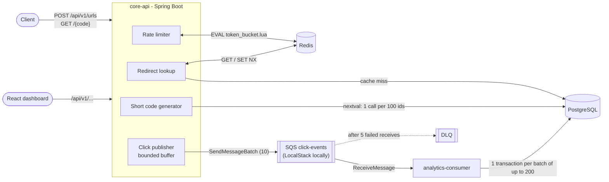

# SnipLink: URL shortener

A URL shortener built with Java 17, Spring Boot 3.2, PostgreSQL 15, Redis 7 and Amazon SQS (LocalStack locally), plus a React dashboard. The point of the project is the backend design: short codes that cannot collide across instances, a rate limiter shared by all instances, a cache that also absorbs requests for unknown codes, and click analytics that never slow a redirect down and never count a click twice.

Every number in this README comes from a load test you can rerun with one command (see [Load test results](#load-test-results)). The raw results are committed under `loadtest/results/`.

## Architecture



**Redirect, `GET /{code}`**
1. The rate limiter takes a token from the client's bucket in Redis (one atomic Lua call); 429 + `Retry-After` if it is empty.
2. Redis `GET url:{code}` returns the original URL, or a tombstone for codes that do not exist or have expired. On a miss, one Postgres lookup, then the result (URL or tombstone) is cached.
3. A click event with a random `eventId` is handed to an in-memory buffer, and the `302` is returned. Nothing on this path waits for SQS or writes to Postgres.

**Click pipeline**
4. Sender threads in core-api drain the buffer and send events to SQS in batches of 10.
5. `analytics-consumer` collects up to 200 events (or 1 second), writes them in one transaction (raw `click_events` rows plus `url_mappings.click_count`) and only then deletes the messages from SQS.

**Create, `POST /api/v1/urls`**: rate limited, then the code comes from the generator (or the requested alias), and the insert itself is what decides uniqueness.

## Design decisions and tradeoffs

### 1. Short codes: database sequence + ID-range leasing + base62

`ShortCodeGenerator` leases a block of 100 ids with one `nextval('short_code_seq')` (the sequence increments by 100) and hands them out from memory. Postgres never returns the same `nextval` twice, so two threads or two app instances can never produce the same id: collisions are impossible by construction, not merely unlikely. Each id is scrambled with `id * M mod 62^7` (M shares no factor with 62^7, so the mapping is one-to-one) and base62-encoded to 7 characters, giving 3.5 trillion codes.

- **Why not random codes?** Random codes need a uniqueness check and retries, and the retry rate grows as the space fills. The sequence needs no retries, and Postgres is touched once per 100 codes.
- **Tradeoff: predictability vs. coordination.** The sequence is a coordination point (Postgres, which is already a hard dependency for creates). Codes derive from a counter: the scramble hides creation order and volume from casual inspection, but it is not a security boundary. If codes had to be unguessable, random codes with a unique constraint would be the better choice.
- Ids left unused in a block when an instance stops are skipped (gaps are fine with 3.5T codes).

**Custom aliases** are inserted directly and the `UNIQUE` constraint on `short_code` picks the winner; the loser gets `409 Conflict`. (The original code checked "exists?" first, so two concurrent requests could both pass the check and the loser got a 500.) If a generated code happens to equal an existing custom alias, the insert fails on the constraint and the next code is used.

### 2. Rate limiting: Redis token bucket in a Lua script

Each client (by IP) has a bucket holding up to N tokens (N = the per-minute limit, which is also the allowed burst), refilled continuously at N/60 per second. `token_bucket.lua` reads the bucket, refills it, takes a token and writes it back. Redis runs a script atomically, so two app instances checking the same client at the same instant cannot both spend the last token. The script uses Redis's clock, so instances with skewed clocks still agree. Rejections return `429` with `Retry-After` (seconds until the next token).

- Limits: 10 creates/min and 100 redirects/min per client by default (`RATE_LIMIT_*` env vars).
- `server.forward-headers-strategy=native`: behind a load balancer on a private network, the client IP comes from `X-Forwarded-For`, not from the load balancer's address.
- **Fails open**: if Redis is down, requests are allowed. Serving traffic was judged more important than enforcing limits during a Redis outage.
- The previous implementation was a fixed one-minute `INCR` window: up to 2x the limit across a window boundary, and a separate, non-atomic `EXPIRE`.

### 3. Asynchronous click analytics over SQS

**Why SQS:** the code already targeted AWS, and SQS provides at-least-once delivery, visibility-timeout redelivery and a dead-letter queue without any code of ours. Locally it runs in LocalStack. Redis Streams would have avoided one container, but would put the analytics backlog in the same Redis that serves the cache and the rate limiter.

**Producer (core-api).** `ClickEventPublisher.publish()` only offers the event to a bounded buffer (10,000 events) and returns. It never blocks or throws.

**When SQS is down**, the buffer absorbs a few seconds of clicks; after that new clicks are **dropped and counted** in the `clicks.dropped` metric, and redirects keep working at normal speed. The alternative, falling back to writing clicks to Postgres from the redirect path, would make redirect latency depend on Postgres write capacity exactly when something is already failing. Losing some analytics during an outage was judged the better trade. (Checked by hand: with LocalStack stopped, 300/300 redirects returned 302 and `clicks.dropped` was 300.)

**Consumer (analytics-consumer): exactly-once counting on at-least-once delivery.**
- Messages are deleted from SQS only **after** the database transaction commits. If the consumer dies before the commit, nothing was written and SQS redelivers the batch.
- If it dies after the commit but before the delete, the batch is redelivered, but every event carries an `eventId` and the insert is `ON CONFLICT (event_id) DO NOTHING`. Only rows actually inserted are added to `click_count`, so a repeat adds nothing.
- `click_count` gets one `UPDATE` per short code per batch, applied in sorted code order so two consumer threads always lock rows in the same order (no deadlocks).
- A message that cannot be parsed is never deleted; after 5 receives SQS moves it to the dead-letter queue.

### 4. Cache correctness

- **Cache-aside, one round trip per hit.** The value is just the URL (or a tombstone).
- **Negative caching.** Unknown or deleted codes are cached as a `!404` tombstone for 60 s, so a burst of requests for a bad code costs one Postgres query per minute, not one per request. Expired codes are cached as `!410`. Creating a code deletes any earlier tombstone for it, so a new alias works immediately.
- **TTL with jitter.** Links are cached for 1 h +/-10%, so entries cached together (for example right after a restart) do not all expire in the same second and send a burst of misses to Postgres.
- **Expiry.** A link's TTL is capped at its `expires_at`, so it leaves the cache when it expires.
- **Deletion** (`DELETE /api/v1/urls/{code}`, admin key required): the row is set inactive, then the cache entry is overwritten with a tombstone. Readers fill the cache with `SET NX` (only if the key is absent), so a reader that loaded the row just before the delete cannot put the old URL back afterwards.
- A cache hit does not open a transaction or borrow a database connection (and `open-in-view` is off).

## Load test results

Load generator: k6 (`loadtest/redirect.js`) against `GET /{code}` on the compose network. 10,000 links are seeded; link popularity follows a Zipf curve (s = 1.0: the top 1% of links get about half the traffic) and 2% of requests ask for codes that do not exist. Each virtual user (VU) loops request, then 0-500 ms think time. Every run starts from a fresh stack (empty Postgres volume, empty Redis), warms up for 30 s, then measures a 2-minute hold. Postgres work is counted with `pg_stat_statements`, the cache hit rate with the app's `url.cache.hit` / `url.cache.miss` counters. Each cell is the mean of 3 runs, with the range in brackets.

Machine: Apple M5 (10 cores, 16 GB), macOS 27.0.1, Docker 29.9.2 with 10 CPUs and 7.7 GB. k6 and the whole stack run on this one machine.

```bash
loadtest/run-bench.sh <label> <on|off> [vus] [runs]   # cache on/off
python3 loadtest/summarize.py                          # tables below
```

**Before vs. after at 500 VUs** (the "before" column is the original code, cache on, as it was before this work):

| Metric | Original code | Final, cache off | Final, cache on |
|---|---|---|---|
| Throughput (req/s) | 1,985 (1,981-1,991) | 1,985 (1,983-1,989) | 1,978 (1,970-1,983) |
| Avg latency (ms) | 0.9 (0.8-0.9) | 0.8 (0.7-0.9) | 1.2 (0.8-2.1) |
| p95 latency (ms) | 1.1 (1.0-1.1) | 1.0 (0.9-1.0) | 1.7 (1.1-2.6) |
| p99 latency (ms) | 4.3 (3.5-4.8) | 4.4 (3.3-5.1) | 16.0 (3.4-40.5) |
| Cache hit rate | 96.1% | n/a | 96.1% |
| Postgres link lookups (SELECT) per run | 9,343 | 239,199 | 9,313 |
| Postgres `click_count` UPDATEs per run | 234,376 | 157,768 | 157,321 |
| Postgres statements per run, all | 478,096 | 631,358 | 400,156 |
| Postgres writes made by the redirect path | 2 per click | 0 | 0 |
| Clicks dropped | n/a | 0 | 0 |

**Phase 1 baseline at 100 VUs** (original code):

| Metric | Cache off | Cache on |
|---|---|---|
| Throughput (req/s) | 397 (395-399) | 398 (397-399) |
| Avg / p95 / p99 latency (ms) | 0.6 / 0.9 / 1.7 | 0.7 / 1.1 / 2.1 |
| Postgres link lookups per run | 47,839 | 6,001 (-87.5%) |
| Postgres statements per run, all | 141,683 | 99,878 (-29.5%) |
| Cache hit rate | n/a | 87.5% |

**What the numbers say**

- **The cache removes about 96% of link lookups from Postgres at 500 VUs** (239,199 to 9,313 SELECTs per run; 87.5% at 100 VUs, where the shorter run leaves more of the long tail uncached). The remaining misses are first requests for long-tail links plus the 2% unknown codes, now one lookup per code per minute thanks to negative caching.
- **The cache does not make redirects faster on this machine.** A Postgres primary-key lookup on a local, memory-resident table takes well under a millisecond, the same as a Redis round trip. Latency would differ with a real network hop or a database under heavy write load; this setup cannot show that.
- **Throughput is set by the test, not the app**: with 0-500 ms think time, 500 VUs offer about 2,000 requests/s and every configuration served all of it with no errors. None of these runs found the system's limit.
- **What changed between the original and the final code is where the work happens.** The original redirect path triggered an INSERT and an UPDATE per click on core-api's own connection pool; now the redirect path does no Postgres writes, and the consumer's batching cut `click_count` UPDATEs by 33% (one per code per batch instead of one per click) and total Postgres statements by 16% at the same load.
- **Variance:** the third final cache-on run had a p99 of 40.5 ms (the other two: 4.2 and 3.4 ms). The cause was not identified; it is reported as measured, and with everything on one laptop such outliers are expected.

## Running locally

Prerequisites: Docker. For the tests: JDK 17 or newer and Maven. For the dashboard: Node.js 20.

```bash
docker compose up -d --build     # Postgres, Redis, LocalStack (SQS), core-api, analytics-consumer
```

The API listens on http://localhost:8080.

```bash
# Create a short URL (generated code)
curl -X POST localhost:8080/api/v1/urls -H 'Content-Type: application/json' \
  -d '{"originalUrl":"https://github.com"}'

# Create with a custom alias (3-10 chars of letters, digits, _ or -) and an expiry
curl -X POST localhost:8080/api/v1/urls -H 'Content-Type: application/json' \
  -d '{"originalUrl":"https://github.com","customCode":"github","expiresInDays":30}'

# Follow the redirect
curl -i localhost:8080/github

# Link info and analytics (clicks appear after the consumer's next batch, about a second)
curl localhost:8080/api/v1/urls/github
curl localhost:8080/api/v1/urls/github/analytics
curl localhost:8080/api/v1/stats

# Delete (soft delete); only works when core-api is started with ADMIN_API_KEY set
ADMIN_API_KEY=change-me docker compose up -d core-api
curl -X DELETE localhost:8080/api/v1/urls/github -H 'X-Admin-Key: change-me'
```

Dashboard:

```bash
cd dashboard && npm install && npm run dev    # http://localhost:5173
```

### API

| Method and path | Responses |
|---|---|
| `POST /api/v1/urls` | 201, 400 (validation), 409 (alias taken), 429 |
| `GET /{code}` | 302, 404 (unknown or deleted), 410 (expired), 429 |
| `DELETE /api/v1/urls/{code}` | 204, 403 (missing or wrong `X-Admin-Key`), 404 |
| `GET /api/v1/urls/{code}` | link info and click count |
| `GET /api/v1/urls/{code}/analytics` | clicks per day, top referers, devices |
| `GET /api/v1/stats` | totals for the dashboard |
| `GET /actuator/health`, `/actuator/metrics/{name}` | e.g. `url.cache.hit`, `url.cache.miss`, `clicks.published`, `clicks.dropped`, `clicks.buffered`, `http.server.requests` |

## Tests

```bash
cd core-api && mvn verify             # 14 tests
cd analytics-consumer && mvn verify   # 2 tests
scripts/e2e-click-count.sh            # full stack, consumer SIGKILLed mid-stream
```

The Maven tests start real Postgres, Redis and LocalStack containers with Testcontainers (Docker must be running). GitHub Actions runs both suites on every push (`.github/workflows/ci.yml`).

| Test | What it proves |
|---|---|
| `ShortCodeConcurrencyTest` | 2,000 parallel creates get 2,000 distinct codes; two generator instances x 20,000 codes never overlap; 20 concurrent requests for one alias give exactly one 201 and nineteen 409s |
| `RateLimitTest` | a 100-request burst is capped at the bucket size; the same cap holds when requests are split across two separate app instances sharing Redis; clients have separate buckets |
| `RedirectClickEventTest` | 500 parallel redirects publish exactly 500 events with 500 distinct ids |
| `ClickEventConsumerTest` | 1,000 events with a consumer restart mid-stream are counted exactly 1,000 times; events committed but not deleted from SQS (a crash) are redelivered and not counted twice |
| `CacheBehaviorTest` | 50 requests for an unknown code cause 1 Postgres lookup; an alias created after a 404 resolves at once; the TTL is capped at the link's expiry, then 410; TTLs are jittered |
| `DeleteLinkTest` | delete needs the admin key; a cached link stops resolving immediately; a slow reader cannot re-cache a deleted link |
| `scripts/e2e-click-count.sh` | on the full compose stack, 3,000 redirects with the consumer killed (SIGKILL) and restarted mid-stream give exactly 3,000 counted clicks |

Several of these were checked against deliberately broken code: without `synchronized` the generator produced 20,479 unique codes out of 40,000; a limiter doing read-then-write from Java instead of Lua let 100 of 100 burst requests through; a consumer that counted repeated events counted 20 clicks for 10.

## Known limitations

- **Not deployed.** Everything runs locally under Docker Compose. The SQS client works against real SQS unchanged (drop `AWS_ENDPOINT_URL`, use IAM credentials), but there is no infrastructure-as-code or deploy pipeline.
- **Load test on one machine.** k6, both services, Postgres, Redis and LocalStack share one laptop, so absolute latencies are lower (no network hops) and throughput is capped by k6's think time rather than by the app. The numbers compare designs; they do not predict production latency.
- **Clicks can be lost by design** when SQS is unavailable for longer than the buffer lasts, or when core-api crashes with events still in its in-memory buffer (up to 10,000). Both are counted or bounded, not prevented.
- **Short codes are predictable in principle** (see decision 1).
- **Rate limits are per IP**, so many users behind one NAT share a bucket; the limiter fails open if Redis is down.
- **`click_events` grows without bound** (one row per click, plus a unique index on `event_id`). A real deployment would partition or roll it up.
- `GET /api/v1/stats` loads every link into memory to compute totals; fine for a demo, not for millions of links. `GET /api/v1/health` always reports UP; use `/actuator/health` for real checks.
- Deletion is a soft delete behind a single shared admin key; there are no user accounts.

## Project structure

```
core-api/                 Spring Boot API: create, redirect, delete, analytics queries; owns the DB schema (Flyway)
  src/main/resources/scripts/token_bucket.lua
analytics-consumer/       Spring Boot worker: SQS poll loop, idempotent batch writes
dashboard/                React + Vite + Recharts dashboard
docker/                   Postgres and LocalStack init scripts
loadtest/                 k6 script, seed data, benchmark runner, committed results
scripts/e2e-click-count.sh
docker-compose.yml
.github/workflows/ci.yml
```
